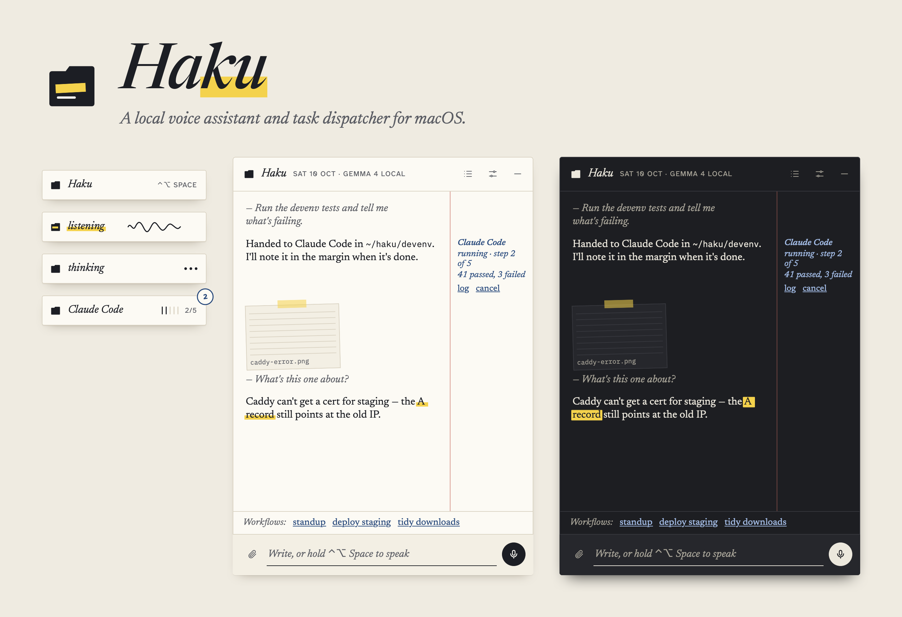
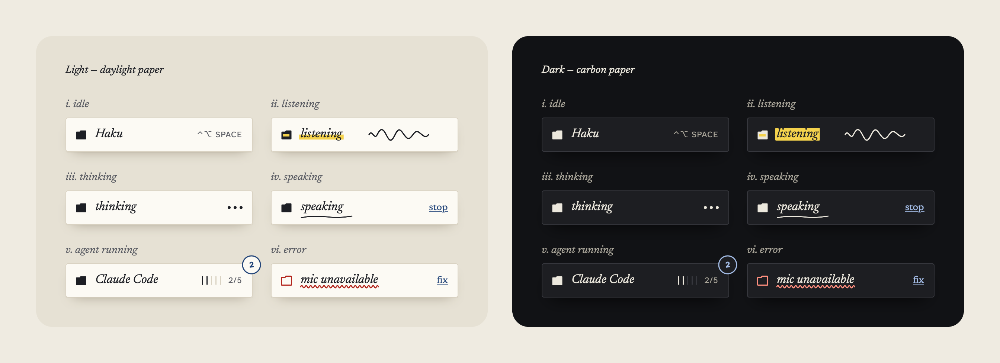
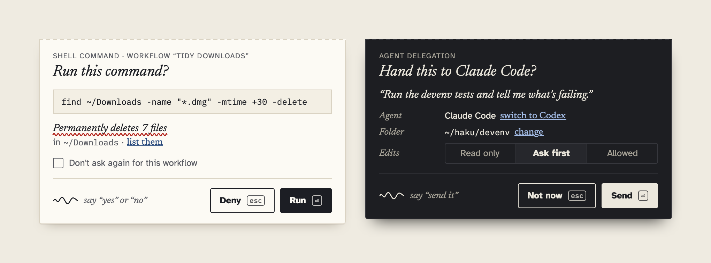
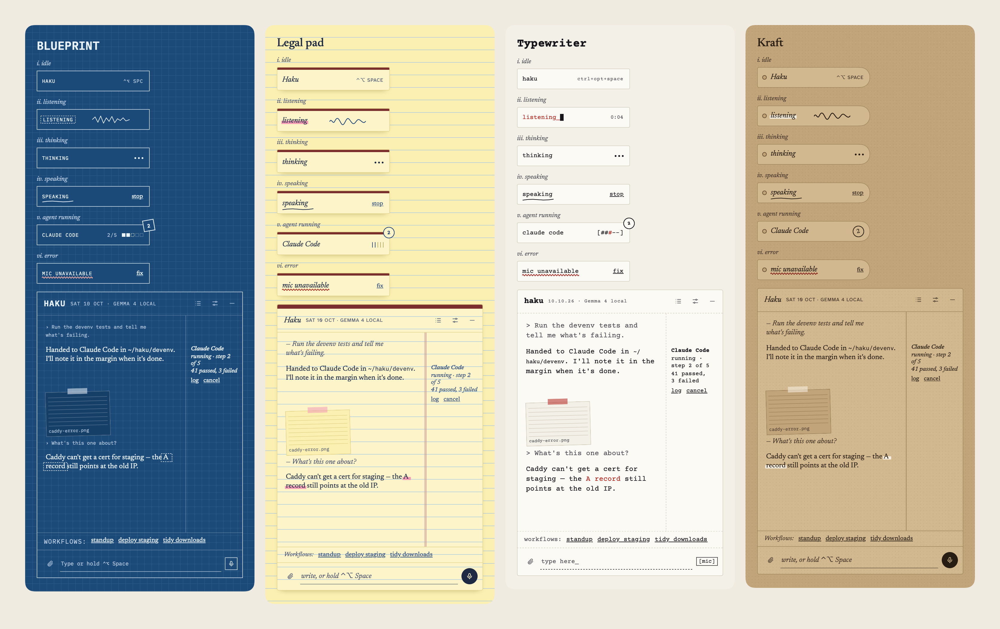
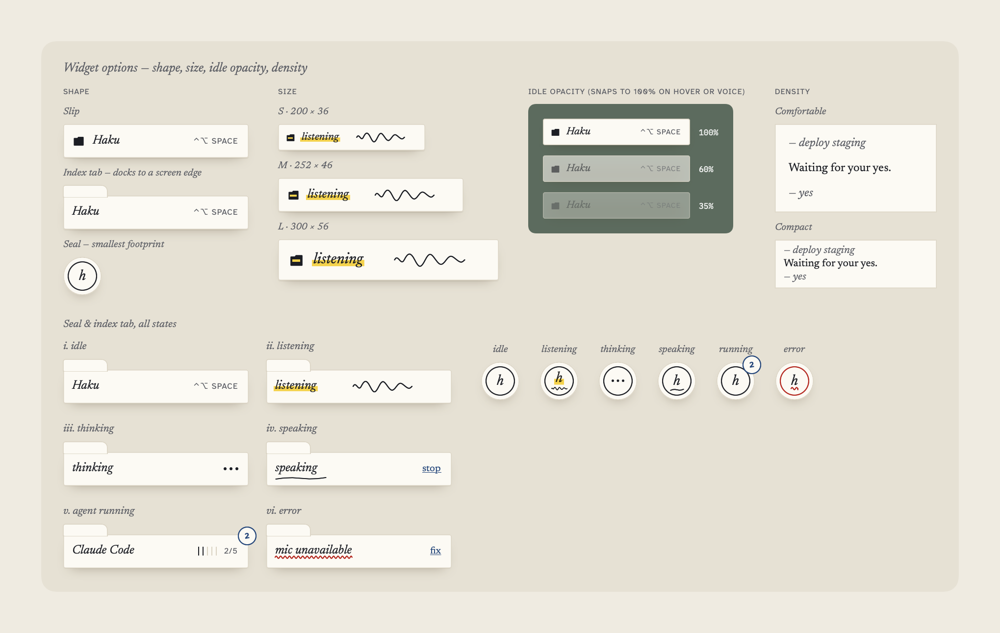

<p align="center">
  
</p>

# Haku

**A local voice assistant and task dispatcher for macOS.**

Haku is a slip of paper that floats on your desktop. Hold a hotkey or say "Haku", then talk or type. It handles the quick things itself: questions, opening apps and sites, running Shortcuts. Coding work goes to agents like **Claude Code** and **Codex**, and their jobs show up as notes in the margin until they're done.

It runs locally by default. Haku uses a model on your own machine (LM Studio, Ollama or any OpenAI-compatible server), and speech recognition, speech output and wake-word detection happen on-device.

> Status: early and moving fast. Built with SwiftUI and AppKit for macOS 15+, best on macOS 26+ with Apple silicon.

---

## What it does

- **Floating widget.** An always-on-top slip that stays out of the way: 60% opacity when idle, solid when it needs you.
  - Hold it (or **⌃⌥Space**) to talk; click it to open the panel. Drop a file or image on it to attach it.
  - Six states: idle, listening (with a live mic squiggle), thinking, speaking, agent running and error.
- **Talk or type.** On-device speech-to-text: macOS SpeechAnalyzer, or WhisperKit for other languages. Replies can be spoken back, and talking over Haku interrupts it.
- **"Haku" wake word.** Haku listens on-device for its name ("Haku, open notes"). It uses a custom-trainable [openWakeWord](https://github.com/dscripka/openWakeWord) model, or on-device speech until you've trained one. It's on by default and you can turn it off.
- **A small local brain.** A fast local model (Gemma 4 E4B by default) routes each request: answer directly, call a tool, hand the question to a bigger local model, or delegate to an agent. Haku loads models on demand.
- **Tools:**
  - open apps and URLs
  - run Shortcuts
  - run AppleScript and shell commands (always confirmed)
  - run saved workflows
  - escalate to a bigger model
  - delegate to Claude Code or Codex
- **Agent delegation.** Haku turns what you said into a clean task prompt and runs `claude -p` or `codex exec` in your project folder. It streams the agent's steps and log into the Tasks view and speaks a short summary when the job is done.
  - Edit permissions: **Read only**, **Ask first** (the agent proposes changes and you approve them) or **Allowed**.
- **Workflows.** Saved commands like "deploy staging" or "standup notes", each mapping trigger phrases to one action: ask the model, shell, script or agent. Templates can use `{after}`, `{clipboard}`, `{selection}`, `{front app}` and `{date}`.
- **Nothing runs without a yes.** Shell commands, scripts and agent hand-offs show a tear-off confirmation slip first. Approve by click, ⏎, or a short spoken "yes". Destructive commands are flagged, and `find … -delete` shows how many files it would remove.
- **Attachments are context only.** Screenshots, images and files are saved to a temp folder and passed to agents as file paths, with no local image analysis. They're deleted when the task finishes, and only text history is kept.
- **A real app too.** The main window has your full chat history, grouped by date and searchable, plus Tasks, Workflows and Settings. The widget, panel and window all continue the same conversation.

<p align="center">
  
</p>

<p align="center">
  
</p>

## Design

The design direction is called **Margin: paper and ink**. Haku speaks in a serif italic, marks what matters with a highlighter, and keeps agent jobs as notes in the margin. There are two base themes, Daylight and Carbon, which follow the system appearance. Four extra themes change texture as well as color: **Blueprint**, **Legal pad**, **Typewriter** and **Kraft**. You can also pick the widget shape (slip, index tab, seal), its size, idle opacity, density and highlighter color.

<p align="center">
  
</p>

<p align="center">
  
</p>

Where the design lives:
- `design/` holds the source of truth. Start with `HANDOFF.md`, then the HTML mockups.
- Colors are generated from [`tools/design-tokens/colors.json`](tools/design-tokens/colors.json) into an asset catalog.
- Every gap or decision the mockups don't cover is logged in [`DESIGN_NOTES.md`](DESIGN_NOTES.md).
- The images in this README are rendered from the app's real SwiftUI views by [`HakuTests/PromoImageTests.swift`](HakuTests/PromoImageTests.swift).

## Requirements

- macOS 15 or later on Apple silicon. On-device speech recognition and the zero-setup wake word need macOS 26+; on older systems Haku uses WhisperKit.
- Xcode 26+ and [XcodeGen](https://github.com/yonaskolb/XcodeGen) (`brew install xcodegen`).
- A local OpenAI-compatible model server: [LM Studio](https://lmstudio.ai) is recommended, Ollama works too.
  - Defaults: `gemma-4-e4b` for routing and `qwen3.8-27b` for harder questions; both can be changed in Settings.
- Optional: the [Claude Code](https://docs.claude.com/en/docs/claude-code) and/or [Codex](https://github.com/openai/codex) CLIs, for agent delegation.

## Build and run

```bash
git clone <this repo> haku && cd haku
xcodegen generate
open Haku.xcodeproj
```

In Xcode, set your own signing team under *Signing & Capabilities*, or change `DEVELOPMENT_TEAM` in `project.yml`, then run the **Haku** scheme. A stable signing identity matters: macOS ties the Microphone, Speech Recognition and Accessibility permissions to it.

To build and test from the command line:

```bash
xcodebuild -project Haku.xcodeproj -scheme Haku -allowProvisioningUpdates build
xcodebuild -project Haku.xcodeproj -scheme Haku -allowProvisioningUpdates test
```

On first launch, a five-step onboarding asks for the microphone, speech recognition and Accessibility permissions. Accessibility is used for the global hotkeys and for reading your selection in workflows. Screen Recording is only requested if you use "attach screenshot".

### Hooking up your model

1. Start your model server. In LM Studio, turn on the local server; just-in-time loading is optional.
2. Haku looks for it on the usual local ports (1234, 1235, …), or you can set the endpoint in **Settings › Models & agents**.
3. If a model isn't loaded, Haku loads it through LM Studio's API or `lms` CLI. The escalation model unloads itself after 10 idle minutes.

For development without a model, there's a tiny mock server: `python3 tools/mock-llm/server.py 1234`.

## Default shortcuts

| Action | Shortcut |
|---|---|
| Hold to talk | ⌃⌥Space |
| Open the panel | ⌥⇧Space |
| Tasks | ⌥⇧T |
| Approve / deny a prompt | ⏎ / esc |
| New chat · main window | ⌘N · ⌘0 |

All shortcuts can be changed in **Settings › Hotkeys & voice**.

## Training the "Haku" wake word

Out of the box, Haku detects its name with on-device speech recognition. For lower power use and fewer false starts, train a dedicated openWakeWord model:

```bash
./tools/wakeword/train_haku.sh
```

This generates synthetic "haku" clips, augments them, trains a small model and installs it. Haku switches to it automatically. Expect roughly 20 GB of downloads and a few hours on Apple silicon. See [`tools/wakeword/README.md`](tools/wakeword/README.md).

## Privacy

- **Model:** your local server. Nothing is sent to a cloud LLM unless you point Haku at one.
- **Speech:** on-device (SpeechAnalyzer or WhisperKit). Text-to-speech uses the system voices.
- **Microphone:** used while you hold the hotkey, while a confirmation is waiting for a spoken answer, and for the wake word if it's enabled.
- **History:** text only, stored in `~/Library/Application Support/Haku/`. You can turn it off or delete it in Settings.
- **Attachments:** copied to a temp folder, passed to agents as file paths, and deleted when the task finishes.
- **Agents:** run as local processes in the folder you choose (default `~/haku`), with the edit permissions you pick.

## Project layout

```
Haku/
  App/            app entry, AppModel (conversation, voice turn-taking, jobs), window controllers
  Main/           main window: chat history sidebar, chat, embedded tasks/workflows/settings
  Widget/         floating widget window, states, shapes, gestures
  Panel/          expanded panel: conversation, margin notes, attachments, input
  Confirm/        confirmation slips + ConfirmationCenter
  Tasks/ Workflows/ Settings/ Onboarding/
  Core/
    LLM/          OpenAI-compatible streaming client, model loading (LM Studio)
    Brain/        routing model + tool definitions + tool execution
    Voice/        mic capture, SpeechAnalyzer/WhisperKit STT, TTS, barge-in, wake word
    Agents/       Claude Code / Codex runners and stream parsers, task store
    Workflows/ Store/ Hotkeys/ Context/ System/
  DesignSystem/   tokens, Theme + ThemeManager, highlighter renderer, paper surfaces, ink marks
HakuTests/        unit tests, contrast checks, snapshot + promo renders
design/           design handoff and mockups (source of truth for visuals)
tools/            design tokens, mock LLM server, wake-word training
```

## Contributing

Issues and pull requests are welcome. Please:
- Keep views free of hardcoded colors and sizes, and add new values to the design tokens.
- Log any design decision the mockups don't cover in `DESIGN_NOTES.md`.
- Make sure `xcodebuild test` passes. It includes a contrast test that keeps every text color at 4.5:1 or better.

## License

No license has been chosen yet. Until one is added, all rights are reserved by the author. The bundled fonts (Newsreader, Atkinson Hyperlegible, IBM Plex Mono, Courier Prime) are under the SIL Open Font License 1.1; see `Haku/Resources/Fonts/OFL-*.txt`.
